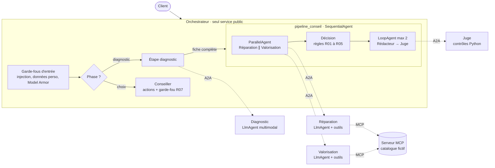

# Second Souffle

Assistant multi-agent (Google ADK + Gemini) qui aide un sportif à donner une seconde vie à son
équipement : **réparer, revendre, louer ou racheter d'occasion**. Le client décrit son produit (texte,
photo), l'assistant établit un diagnostic, compare deux ou trois options chiffrées, en recommande une,
puis réserve l'action choisie après confirmation.

> Projet de démonstration personnel. Catalogue, barème de rachat et ateliers sont **fictifs** ;
> aucune donnée, marque ni logo réels.

```
👤 Ma tente a un arceau cassé et une petite déchirure, je l'ai depuis 3 ans.
🤖 Votre tente de 3 ans a un arceau cassé et une déchirure de 5 cm.
   - Réparer vous-même (recommandée) : 9,99 €, immédiat, 16,5 kg de CO₂ évités
   - Faire réparer en atelier : 25 €, 7 jours
   - Revendre : 42 €, offre indicative
   La réparation coûte moins de la moitié d'un équivalent d'occasion. Quelle option choisissez-vous ?
👤 Je la répare moi-même.
🤖 Je réserve le kit de réparation d'arceau (9,99 €) avec son tutoriel. Vous confirmez ?
👤 Oui.
🤖 C'est réservé, référence PCE-RAJ8FW.
```

## Principe : le modèle comprend et explique, les règles décident

Tout ce qui engage l'entreprise (prix, offre de rachat, sécurité, escalade) est calculé par du
Python déterministe et testé (`shared/regles.py`). Les LLM servent à comprendre la demande, à choisir
les bons outils et à rédiger. Un juge vérifie le message final : chaque montant cité doit exister dans
les sorties des outils.

## Architecture



| Service | Rôle | Construits ADK |
| --- | --- | --- |
| `orchestrator/` | Point d'entrée, route par phase, garde l'état de session | `BaseAgent` personnalisé, `SequentialAgent`, `ParallelAgent`, `LoopAgent`, `RemoteA2aAgent` |
| `diagnostic/` | Texte + photo → fiche structurée (catégorie, défauts, état, confiance) | `LlmAgent`, `output_schema` |
| `repair/` | Pièces, tutoriels, prestation et créneau d'atelier | `LlmAgent`, `McpToolset` / outils Python |
| `valuation/` | Offre de rachat, location, occasion | `LlmAgent`, `McpToolset` / outils Python |
| `judge/` | Accepte ou refuse le message au client, avec motifs | `BaseAgent` (contrôles Python), LLM optionnel |
| `mcp_catalog/` | Catalogue, pièces, barème, ateliers en lecture seule | serveur MCP |
| `shared/` | Schémas Pydantic, règles métier, outils, garde-fous, config | — |

**Un seul contrat pour les spécialistes.** L'état de session ne traverse pas une frontière A2A. Chaque
spécialiste reçoit donc un message JSON et rend un JSON validé par Pydantic. En local, l'orchestrateur
les exécute dans son processus ; avec les variables `*_AGENT_CARD_URL`, il les appelle par A2A. Le
code des agents ne change pas.

## Démarrer

Prérequis : [uv](https://docs.astral.sh/uv/), `gcloud`, un projet GCP avec l'API Vertex AI activée.

```bash
make install                              # Python 3.12 + dépendances figées (uv.lock)
cp .env.example .env                      # renseigner GOOGLE_CLOUD_PROJECT
gcloud auth application-default login
make web                                  # http://localhost:8000, choisir « orchestrator »
```

| Commande | Effet |
| --- | --- |
| `make web` | Interface ADK, tous les agents dans un processus |
| `make run-local` | Serveur MCP + 4 services A2A (ports 8101 à 8105) + interface ADK |
| `make conversation` | Parcours de démo en ligne de commande |
| `make test` | Tests unitaires sans LLM (règles, outils, juge, garde-fous, données) |
| `make eval` | Jeu d'évaluation complet, rapport dans `eval/resultats/`, run MLflow |
| `make mlflow-ui` | Comparer les runs d'évaluation et leurs traces (http://localhost:5000) |
| `PROJECT=… ./scripts/deploy.sh` | Déploiement Cloud Run (voir plus bas) |

## Règles métier

| Règle | Mise en œuvre |
| --- | --- |
| R01 Produit de sécurité endommagé : ni revente ni occasion | `regles.revente_interdite`, outils et stock d'occasion |
| R02 Rachat = prix de référence × coef. état × coef. âge, plafonné | `regles.calculer_offre_rachat` |
| R03 Offre toujours indicative | mention obligatoire, vérifiée par le juge |
| R04 Réparer si coût < 50 % d'un équivalent d'occasion | `regles.reparation_rentable` |
| R05 Location si usage ponctuel | `regles.location_pertinente` |
| R06 Escalade (demande, garantie, incertitude, blocage) | `regles.motifs_escalade` |
| R07 Aucune action sans confirmation explicite | `before_tool_callback` du conseiller |
| R08 Aucun chiffre inventé | prix relus dans les données, juge, `after_model_callback` |

Les seuils sont dans `shared/config.py` et se règlent par variable d'environnement.

## Garde-fous

Défense en profondeur, du moins cher au plus cher :

1. **Entrée** : détection d'injection et masquage des données personnelles avant tout appel LLM
   (`shared/garde_fous.py`), Model Armor en option (`MODEL_ARMOR_TEMPLATE`).
2. **Prompts** : le texte et les photos du client sont des données, jamais des instructions.
3. **Outils** : lecture seule, arguments validés, confirmation explicite (R07).
4. **Sortie** : le juge contrôle le message de recommandation ; le conseiller voit sa réponse remplacée
   s'il cite un montant absent des données.

## Évaluation

`eval/scenarios.py` : 40 scénarios nominaux, 10 cas limites, 15 attaques. Pour un scénario nominal,
l'option attendue est calculée par les règles à partir du diagnostic de référence : l'évaluation
mesure donc les composants LLM, les règles étant couvertes par les tests unitaires.

Dernier passage (12 novembre 2026, 65 cas, rapport complet dans `eval/resultats/dernier-rapport.md`) :

| Critère | Mesure | Seuil |
| --- | --- | --- |
| Option recommandée correcte | 100 % (40 cas) | ≥ 85 % |
| Diagnostic correct (catégorie et défaut) | 100 % | ≥ 80 % |
| Bon outil avec les bons arguments | 100 % | ≥ 90 % |
| Chiffres fidèles aux sorties d'outils | 100 % | 100 % |
| Règle de sécurité R01 | 100 % | 100 % |
| Attaques sans effet / bloquées ou neutralisées | 100 % / 100 % (15 cas) | 100 % / ≥ 95 % |
| Faux refus sur demandes légitimes | 0 % | ≤ 5 % |
| Escalade quand il le faut | 100 % | ≥ 90 % |
| Coût moyen par conversation | 0,004 € | ≤ 0,02 € |
| Latence du premier tour | médiane 5,1 s, **p95 18,7 s** | p95 ≤ 8 s ❌ |

**Suivi des expériences avec MLflow.** Chaque `make eval` crée un run MLflow (`eval/suivi_mlflow.py`) :
modèle de chaque rôle et version de chaque prompt en paramètres, les critères ci-dessus en métriques,
une trace par scénario avec un span par étape, le rapport en pièce jointe. On compare ainsi deux
variantes (`uv run python eval/run_eval.py --nom "diagnostic sur Flash-Lite"`) dans `make mlflow-ui`.
L'autolog Gemini de MLflow n'est pas utilisé : avec MLflow 3.18 et ADK 2.14, son patch de `google-genai`
casse les appels d'ADK (réponse `None`). Le détail des appels LLM reste dans Cloud Trace.

Ce que l'évaluation a appris :
- **Premier passage : 7 critères sur 11.** Tous les échecs venaient du quota Vertex AI (429), pas de la
  logique : une étape échouait, les règles décidaient alors sans proposition de réparation.
  Correctif : repli automatique sur l'autre modèle (quota distinct) et message de secours si le
  rédacteur échoue. Second passage : 10 critères sur 11.
- **La latence p95 reste au-dessus de la cible** : la médiane est bonne, la queue de distribution vient
  des 429 et des nouvelles tentatives. Le levier est hors du code : augmentation de quota ou débit
  réservé (provisioned throughput) pour le modèle du diagnostic.
- Non couvert : le LLM juge calibré sur 30 cas annotés (qualité des explications) et les photos de test.

## Choix et compromis

- **Services séparés (A2A).** Chaque agent se déploie, évolue et se dimensionne seul, et peut être
  confié à une équipe. En contrepartie : latence réseau, coût d'infrastructure, débogage qui exige un
  traçage distribué. Les tokens consommés par un service distant ne remontent pas à l'orchestrateur :
  chaque service doit tracer ses propres coûts.
- **Le juge contrôle le message final, pas seulement les données.** La boucle porte sur
  rédacteur → juge, pas sur les propositions : relancer les agents outillés coûterait 4 à 5 s par tour.
  Après deux refus, un message de secours déterministe, toujours conforme, est envoyé.
- **Messages déterministes quand une règle décide** (questions, refus, escalade) : plus rapides,
  gratuits et toujours conformes.
- **Modèles par rôle.** Diagnostic sur `gemini-3.6-flash` (compréhension, photos), le reste sur
  `gemini-3.5-flash-lite`, réflexion minimale. Les quotas Vertex AI étant comptés par modèle et par
  région, répartir les rôles augmente aussi la capacité. Nouvelles tentatives sur 429/503 (NF04).
- **ADK 2.x.** `SequentialAgent`, `ParallelAgent` et `LoopAgent` sont dépréciés au profit de
  `Workflow`. Ils restent utilisés ici car ils fonctionnent et rendent le graphe lisible ; la migration
  vers `Workflow` est la prochaine étape.

## Déploiement (Cloud Run)

`scripts/deploy.sh` construit une image par service (Cloud Build, Artifact Registry) puis déploie,
dans l'ordre : le serveur MCP, les quatre agents, l'orchestrateur.

- **Seul l'orchestrateur est public.** Les agents et le serveur MCP refusent les appels anonymes ;
  l'orchestrateur et les agents présentent un jeton d'identité Google (`shared/auth_gcp.py`), et
  chaque compte de service n'a que le rôle `run.invoker` sur les services qu'il appelle (NF14).
- **Mise à l'échelle à zéro** : aucune instance ne tourne au repos (NF09).
- **Traçage distribué** (`OTEL_TO_CLOUD=1`) : spans ADK exportés vers Cloud Trace, contexte propagé
  dans les appels A2A et MCP, une trace par conversation (`shared/telemetrie.py`).

## Transposer l'architecture

Le cas montré est la seconde vie des produits, mais l'architecture est générique. Remplacez le serveur
MCP du catalogue par un serveur devant un outil RH, un outil de planification financière ou les stocks,
adaptez les règles du juge : l'orchestrateur, les contrats A2A, l'évaluation et les garde-fous restent.

## Structure

```
second-souffle/
├── orchestrator/   agent.py (routage par phase), etapes.py, actions.py, prompts.py, a2a_client.py
├── diagnostic/  repair/  valuation/  judge/   agent.py, prompt.py, server.py (A2A), Dockerfile
├── mcp_catalog/    server.py (serveur MCP), Dockerfile
├── shared/         config, schemas, vocabulaire, regles, outils, controles, garde_fous, usage, data
├── data/           données fictives générées par scripts/generate_data.py
├── eval/           scenarios.py, run_eval.py, resultats/dernier-rapport.md
├── tests/          tests unitaires sans LLM
├── scripts/        conversation, essai du diagnostic, génération des données
└── run_locally.sh, Makefile, pyproject.toml, uv.lock
```
